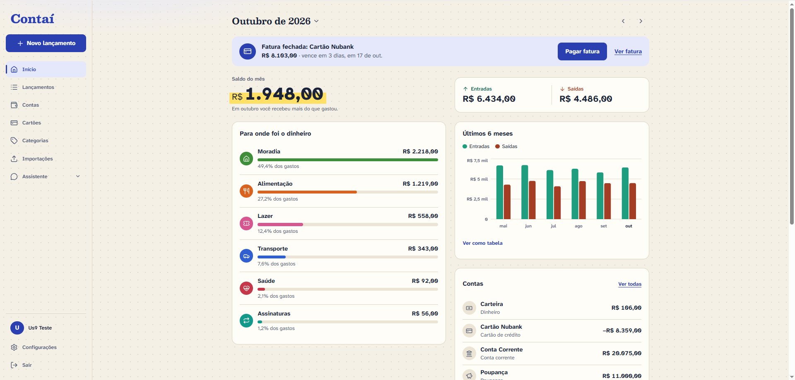
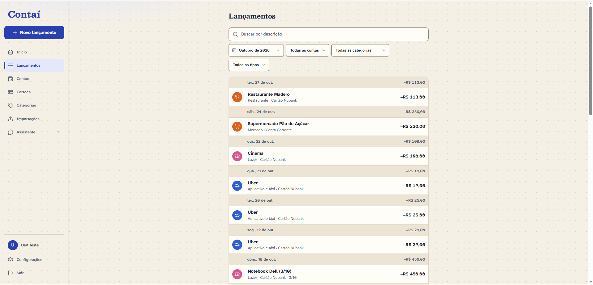
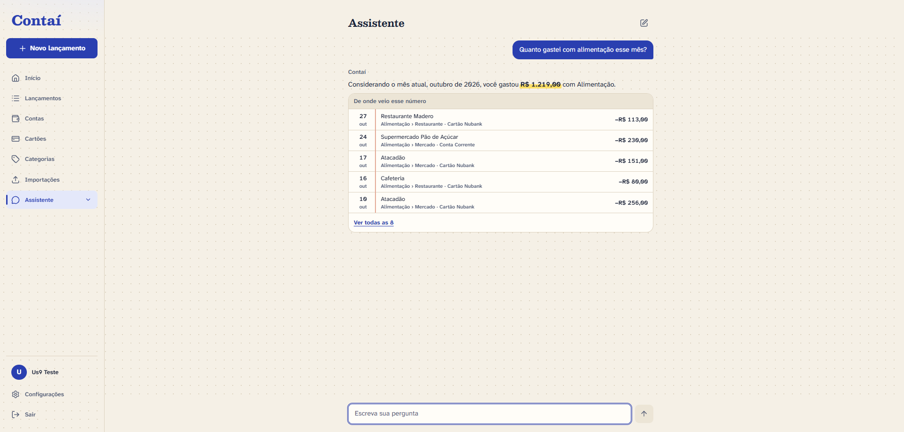
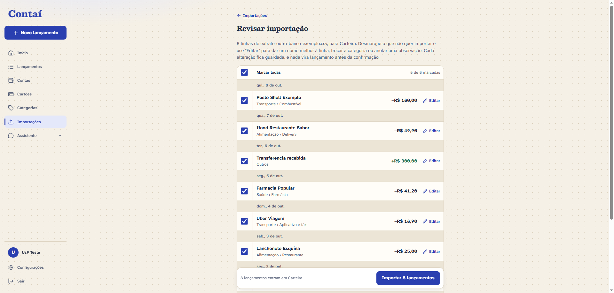
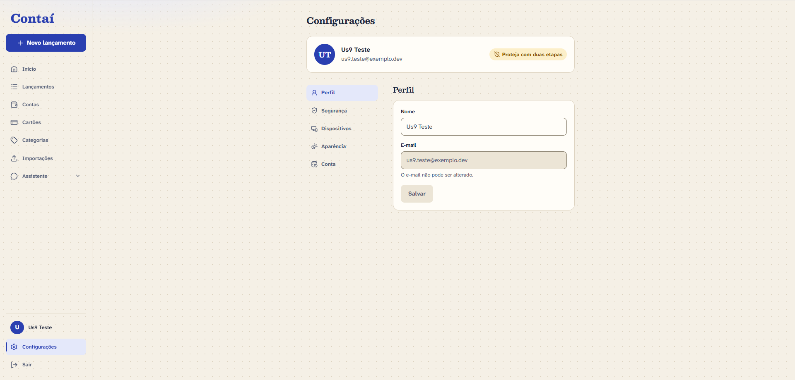

<div align="center">

# 💰 Contaí

### Controle financeiro pessoal em português, com importação de extratos e um assistente que responde com os seus próprios números.


</div>

---

## 📑 Índice

- [Sobre o projeto](#-sobre-o-projeto)
- [Funcionalidades](#-funcionalidades)
- [Capturas de tela](#-capturas-de-tela)
- [Stack](#-stack)
- [Arquitetura](#-arquitetura)
- [Estrutura de pastas](#-estrutura-de-pastas)
- [Segurança e privacidade](#-segurança-e-privacidade)
- [Acessibilidade](#-acessibilidade)
- [Qualidade e testes](#-qualidade-e-testes)
- [Decisões técnicas (ADRs)](#-decisões-técnicas-adrs)
- [Como rodar localmente](#-como-rodar-localmente)
- [Dados de demonstração](#-dados-de-demonstração)
- [Roadmap](#-roadmap)
- [Autor](#-autor)

---

## 📖 Sobre o projeto

O **Contaí** é um aplicativo de finanças pessoais pensado para quem **não é da área de finanças**:
a linguagem é simples, os números são confiáveis e a privacidade vem em primeiro lugar. A pessoa
lança gastos à mão, importa extratos do banco (OFX, CSV, planilha, PDF e imagem) ou simplesmente
escreve uma frase para o assistente — e acompanha para onde o dinheiro vai, mês a mês.

> Projeto pessoal, também usado como **peça de portfólio**. Foi construído de ponta a ponta com
> uma especificação formal (_spec-driven development_): requisitos, plano, pesquisa técnica e
> tarefas vivem em [`specs/001-contai-mvp/`](specs/001-contai-mvp/), e cada decisão de arquitetura
> está registrada como um [ADR](docs/adr/). As 10 histórias de usuário do MVP estão implementadas,
> testadas e conferidas.

**O que este projeto demonstra:**

- Uma aplicação full-stack real (API assíncrona com worker embutido, SPA e banco), com Docker
  Compose no desenvolvimento e publicada só em planos gratuitos (Vercel, Render e Neon).
- Domínio financeiro com exatidão: dinheiro em centavos inteiros, saldo e fatura sempre calculados.
- Integração com LLM com **garantia numérica** — o assistente nunca apresenta um valor que não
  tenha vindo das ferramentas do próprio sistema.
- Preocupação de produto com segurança, privacidade, acessibilidade e desempenho, cobertas por
  testes automatizados.

---

## ✨ Funcionalidades

Organizadas pelas 10 histórias de usuário do MVP:

| # | História | Destaques |
|---|----------|-----------|
| 1 | **Criar conta e entrar com segurança** | Cadastro com confirmação de e-mail, Argon2id, bloqueio após tentativas, recuperação de senha. |
| 2 | **Organizar contas e lançar à mão** | Contas (corrente, poupança, carteira, cartão), categorias com ícone e cor, lançamento rápido. |
| 3 | **Entender o mês pelo painel** | Saldo, entradas/saídas, gastos por categoria e maiores despesas, com gráficos. |
| 4 | **Cartão, parcelas e transferências** | Faturas derivadas por data de fechamento, compras parceladas e transferências entre contas. |
| 5 | **Importar OFX, CSV e planilha** | Leitura tolerante de bancos brasileiros, mapeamento de colunas e detecção de duplicatas em 3 níveis. |
| 6 | **Perguntar ao assistente** | Chat que consulta os dados reais e responde com valores conferidos contra as ferramentas. |
| 7 | **Importar PDF e imagem** | Extração por IA de extratos, faturas e comprovantes, com aviso e consentimento antes do envio. |
| 8 | **Lançar escrevendo uma frase** | "Gastei 50 no mercado ontem" vira uma proposta de lançamento para confirmar. |
| 9 | **Reforçar a proteção da conta** | Verificação em duas etapas (TOTP), códigos de recuperação, sessões ativas e recuperação por e-mail. |
| 10 | **Levar os dados ou excluir a conta** | Exportação completa em ZIP e exclusão com 7 dias para desistir. |

---

## 🖼 Capturas de tela

As imagens ficam em [`docs/screenshots/`](docs/screenshots/) — veja ali como gerá-las.

| Painel | Lançamentos | Assistente |
|:------:|:-----------:|:----------:|
|  |  |  |

| Importação (revisão) | Configurações |
|:--------------------:|:-------------:|
|  |  |

---

## 🧰 Stack

### Backend — `backend/`
- **Python 3.12**, **FastAPI** e **Uvicorn** (API assíncrona).
- **SQLAlchemy 2 (async)** + **Alembic** sobre **PostgreSQL 17** (driver **asyncpg**).
- **Pydantic 2** / **pydantic-settings** para schemas e configuração.
- **Argon2** (senhas), **PyJWT** (access token), **pyotp** + **cryptography/Fernet** (2FA),
  **slowapi** (rate limit).
- Importadores: **ofxtools** (OFX), **openpyxl** (planilha), **filetype** (tipo real do arquivo),
  **defusedxml** (XML seguro).
- IA: **google-genai** (Gemini), atrás de uma interface própria com um provedor simulado nos testes.
- Fila de jobs e tarefas periódicas no próprio PostgreSQL — **sem broker externo**.

### Frontend — `frontend/`
- **React 19** + **TypeScript** + **Vite**.
- **Tailwind CSS 4** com tokens próprios (temas claro/escuro), **Motion** (animações),
  **Recharts** (gráficos), **lucide-react** (ícones).
- **TanStack Query** (dados do servidor), **React Hook Form** + **Zod** (formulários),
  **React Router**, **qrcode.react** (QR do 2FA).

### Infraestrutura
- **Produção**, só em planos gratuitos: **Vercel** (frontend e repasse de `/api`), **Render** (API
  em contêiner Docker) e **Neon** (PostgreSQL gerenciado), com e-mails pela API do **Brevo** e
  tarefas agendadas disparadas pelo **GitHub Actions**.
- **Desenvolvimento**: **Docker Compose**, com **Caddy** como proxy na mesma origem e **Mailpit**
  para os e-mails.

### Qualidade
- Backend: **Ruff** (lint + format), **mypy**, **pytest** (+cobertura), **pip-audit**.
- Frontend: **ESLint**, **Prettier**, **tsc**, **Vitest**, **npm audit**.

---

## 🏗 Arquitetura

O navegador fala com **uma origem só**: a Vercel entrega o app e repassa `/api` para a API, que
nunca é chamada direto.

```text
                       ┌──────────────────────────┐
         navegador ──► │          Vercel          │  app estático · CSP/HSTS · cache
                       └────────────┬─────────────┘
                     /api/* + segredo do repasse
                       ┌────────────▼─────────────┐        ┌─────────────────┐
  GitHub Actions ────► │       API no Render      │ ─────► │  Brevo (e-mail) │
  (tarefas a cada 3 h) │  FastAPI + worker junto  │        └─────────────────┘
                       └────────────┬─────────────┘
                       ┌────────────▼─────────────┐
                       │   PostgreSQL no Neon     │  dados, fila de jobs e
                       │                          │  arquivos até serem lidos
                       └──────────────────────────┘
```

- **Uma origem só**: a Vercel repassa `/api` ao Render com um cabeçalho secreto, e a API recusa
  quem chega sem ele. O cookie de refresh fica `httpOnly`, `Secure` e `SameSite=Strict`, sem CORS.
- **Servidor que dorme**: o Render gratuito dorme depois de 15 minutos sem acesso e leva cerca de
  um minuto para acordar; o app avisa enquanto espera. As tarefas com prazo rodam por um disparo
  do GitHub Actions a cada 3 horas, e não dependem de alguém usar o app.
- **No ambiente local**, o Docker Compose sobe o PostgreSQL, a API (com o worker embutido), o
  servidor do Vite, o Caddy, que faz o papel da Vercel, e o Mailpit.

- **Backend por domínio**: cada módulo em `app/modules/<domínio>/` segue
  `router → service → repository → models/schemas`. **Só o repositório toca o banco**, e todo
  método que lida com dados do usuário exige o `user_id` — o isolamento entre contas é verificado
  por testes dedicados.
- **Worker**: roda dentro do processo da API e consome uma fila de jobs no próprio PostgreSQL
  (`SELECT ... FOR UPDATE SKIP LOCKED`), com novas tentativas por backoff. Cuida de e-mails,
  importações, exclusões de conta vencidas, desativação de 2FA e limpezas periódicas, cada tarefa
  periódica sob um advisory lock próprio. Os jobs chamam serviços dos módulos — nunca SQL direto.
- **Frontend por feature**: `src/features/<domínio>/` com `components`, `hooks`, `services` e
  `types`; o access token vive só em memória e é renovado por um refresh token em cookie `httpOnly`.
- **Migrações** com Alembic rodam na subida da API.

---

## 📂 Estrutura de pastas

```text
Contaí/
├── backend/
│   ├── app/
│   │   ├── core/           # config, banco, logging, segurança, rate limit, relógio
│   │   ├── email/          # envio e modelos de e-mail
│   │   ├── modules/        # auth, users, accounts, categories, transactions,
│   │   │                   # imports, categorization, dashboard, assistant
│   │   ├── worker/         # fila de jobs e tarefas periódicas
│   │   └── main.py         # fábrica do app, middlewares e cabeçalhos de segurança
│   ├── alembic/            # migrações
│   ├── scripts/            # ferramentas de dev (ex.: seed_demo) — fora da imagem de produção
│   └── tests/              # unit, integration e isolation (isolamento entre usuários)
├── frontend/
│   └── src/
│       ├── components/     # UI base e layout
│       ├── features/       # uma pasta por domínio
│       ├── lib/            # cliente HTTP, rotas, formatação de dinheiro/datas
│       └── styles/         # tokens e CSS global
├── infra/                  # Caddy e PostgreSQL de desenvolvimento, backup
├── docs/
│   ├── adr/                # decisões de arquitetura
│   └── screenshots/        # imagens do README
├── specs/001-contai-mvp/   # especificação, plano, pesquisa, contratos e tarefas
├── .github/workflows/      # CI e disparo das tarefas agendadas
├── docker-compose.yml      # ambiente de desenvolvimento
└── .env.example            # variáveis de ambiente comentadas
```

---

## 🔒 Segurança e privacidade

- **Senhas** com Argon2id e verificação contra uma lista de senhas comuns; bloqueio após tentativas
  erradas (persistido no banco, sobrevive a reinícios).
- **Sessões** com access token de 15 min (em memória) + refresh token opaco rotacionado; reutilizar
  um token antigo derruba a sessão inteira. Encerrar sessão, trocar senha ou excluir a conta valem
  na requisição seguinte, não só quando o JWT expira.
- **Verificação em duas etapas** (TOTP) com segredo cifrado (Fernet) e códigos de recuperação de
  uso único.
- **Cabeçalhos de segurança** (CSP, HSTS, `X-Content-Type-Options`, `Referrer-Policy`) e limites de
  frequência por IP e por usuário.
- **Logs sem dados sensíveis** por construção: uma lista do que _pode_ ser registrado; senha, token,
  descrição, valor e conteúdo de documento nunca saem (coberto por teste).
- **Privacidade**: cada pessoa vê só os próprios dados; à IA vai só o mínimo (descrições e nomes de
  categoria, nunca a senha nem o histórico completo); documentos enviados são apagados após a
  leitura; dá para **baixar tudo** e **excluir a conta** (com 7 dias para desistir). A política de
  privacidade diz onde os dados ficam e quais empresas recebem o quê.

---

## ♿ Acessibilidade

- Layout em **320px** e desktop, **temas claro e escuro** só com tokens.
- Navegação por teclado com **foco sempre visível**; todo botão de ícone tem `aria-label` (exigido
  por tipo no TypeScript) e todo campo tem rótulo.
- Contraste conferido, informação **nunca só pela cor**, e respeito a **movimento reduzido**
  (`prefers-reduced-motion`).

---

## ✅ Qualidade e testes

- **Backend**: 1.322 testes (unit, integração e isolamento entre usuários), **98% de cobertura** em
  `app/modules`. Um teste garante que **toda rota autenticada** tem caso de isolamento.
- **Frontend**: 468 testes (componentes e rotas) com Vitest + Testing Library.
- Lint, formatação e checagem de tipos em CI nos dois lados.

```sh
# Backend
docker compose exec api python -m pytest
docker compose exec api ruff check app tests && docker compose exec api ruff format --check app tests

# Frontend
docker compose exec frontend npx vitest run
docker compose exec frontend npm run lint && docker compose exec frontend npm run format:check
```

---

## 📐 Decisões técnicas (ADRs)

As escolhas de arquitetura ficam registradas em [`docs/adr/`](docs/adr/):

| ADR | Decisão |
|-----|---------|
| [0001](docs/adr/0001-fila-de-jobs-no-postgresql.md) | Fila de jobs no PostgreSQL (sem broker externo) |
| [0002](docs/adr/0002-sessoes-e-tokens.md) | Sessões, access token e refresh token |
| [0003](docs/adr/0003-camada-de-ia-e-garantia-numerica.md) | Camada de IA e garantia numérica das respostas |
| [0004](docs/adr/0004-dinheiro-em-centavos-e-saldo-calculado.md) | Dinheiro em centavos e saldo sempre calculado |
| [0005](docs/adr/0005-importadores-e-duplicatas.md) | Importadores e detecção de duplicatas |
| [0006](docs/adr/0006-uploads-em-volume-privado.md) | Uploads em volume privado (substituído pelo 0011) |
| [0007](docs/adr/0007-backup-cifrado.md) | Backup diário cifrado com chave pública, guardado por 14 dias |
| [0008](docs/adr/0008-politica-de-seguranca-de-conteudo.md) | Política de segurança de conteúdo (CSP) |
| [0009](docs/adr/0009-modulo-categorization.md) | Módulo `categorization` como domínio |
| [0010](docs/adr/0010-hospedagem-em-planos-gratuitos.md) | Hospedagem em planos gratuitos: Vercel, Render e Neon |
| [0011](docs/adr/0011-arquivos-enviados-no-banco.md) | Arquivos enviados no banco até serem lidos, fora do backup |

O contexto completo de cada escolha está em
[`specs/001-contai-mvp/research.md`](specs/001-contai-mvp/research.md).

---

## 🚀 Como rodar localmente

**Pré-requisitos:** Docker e Docker Compose.

```sh
# 1. Variáveis de ambiente (os padrões já servem para desenvolvimento)
cp .env.example .env

# 2. Suba tudo (a API aplica as migrações e roda o worker junto)
docker compose up --build
```

> Quem tinha o ambiente de antes do worker embutido deve subir com
> `docker compose up -d --build --remove-orphans`, que remove o antigo contêiner `worker`.

Depois, abra:

- **App:** <http://localhost:8080>
- **E-mails (Mailpit):** <http://localhost:8025> — onde chegam os links de confirmação e recuperação.

> **Dica:** em desenvolvimento use **Chrome ou Firefox**. O cookie de sessão é `Secure`, e o Safari
> pode não guardá-lo em `http://localhost`.

Sem configurar a IA, o provedor **simulado** responde sem acessar a rede. Para usar o Gemini de
verdade, defina `AI_PROVIDER=gemini`, `AI_API_KEY` e os modelos no `.env` (veja as notas sobre a
cota do plano gratuito no [`.env.example`](.env.example)).

---

## 🌱 Dados de demonstração

Para encher o ambiente local com um usuário e **5.000 lançamentos** fictícios:

```sh
docker compose run --rm api python -m scripts.seed_demo
```

Entra com `demo@contai.local` / `conta demonstracao 2026`. O seed se recusa a rodar em produção.

---

## 🗺 Roadmap

O MVP (histórias 1–10) está completo e a hospedagem em planos gratuitos já está no ar, com o worker
embutido na API, os arquivos enviados no banco, os e-mails pelo Brevo e o disparo das tarefas
agendadas. Falta fechar a produção:

- [ ] Backup diário cifrado com `age`, guardado por 14 dias num repositório privado.
- [ ] Ensaio de restauração do backup.
- [ ] Deploy por GitHub Actions, só com o CI verde.
- [ ] Validação de ponta a ponta em produção, com o provedor de IA real.

---

## 👤 Autor

Feito por **Yuri Hayakawa** · [GitHub](https://github.com/YuriiHayakawa)

Projeto pessoal e de portfólio, distribuído sob a licença [MIT](LICENSE).
